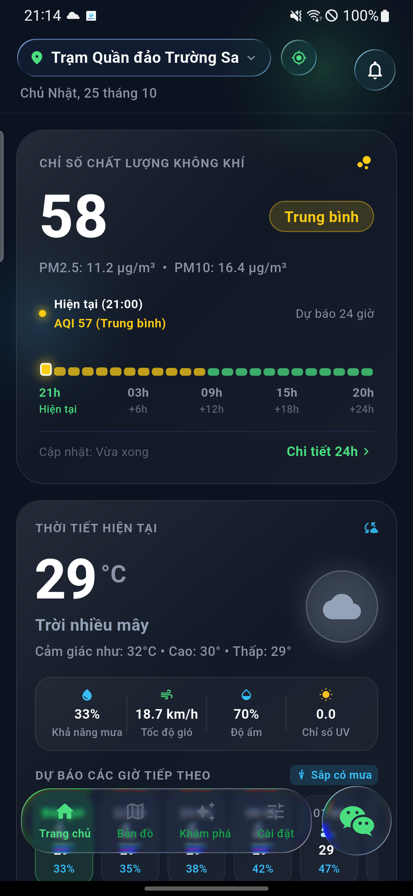
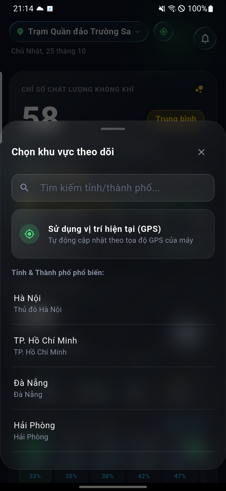
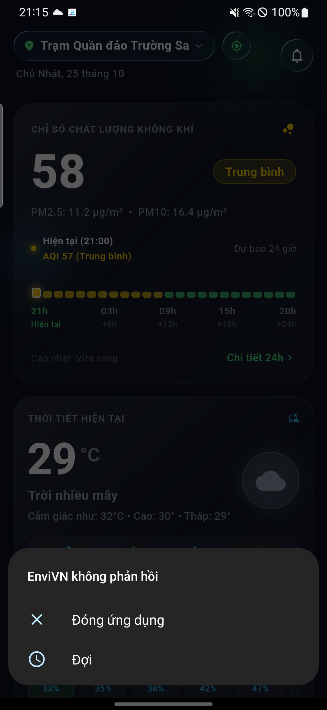
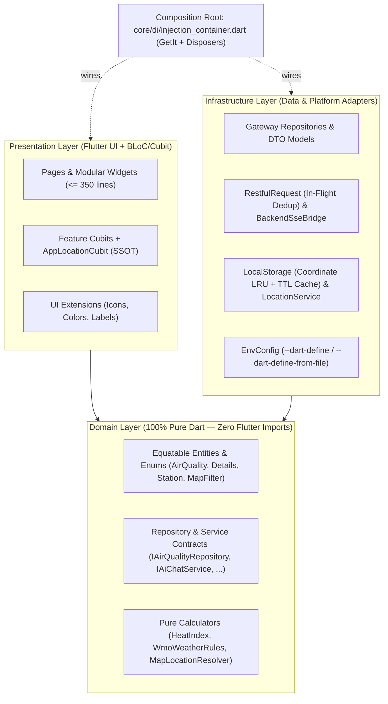

<div align="center">


# EnviVN — Flutter Environmental Monitoring & Early-Warning App

[](https://flutter.dev)
[](https://dart.dev)
[](https://bloclibrary.dev)
[](#3-flutter-architecture--directory-structure)
[-brightgreen)](#7-testing--quality-gates)
[](#7-testing--quality-gates)
[](#8-companion-backend-gateway)
[](LICENSE)

**A production-hardened Flutter mobile application for real-time environmental monitoring, multi-layer GIS mapping, and AI health advisory across Vietnam.**  
Engineered with **Pure Clean Architecture**, **BLoC/Cubit**, **GetIt DI**, **60fps rendering optimizations**, **offline TTL/LRU caching**, and **Android R8 release hardening** — backed by a lightweight Rust (Axum) + Local Ollama companion gateway under a **Strict Thin Client** model.

[English Documentation](#english-documentation) • [Hướng Dẫn Tiếng Việt](#hướng-dẫn-tiếng-việt)

</div>

---

<a id="english-documentation"></a>

## English Documentation

### Table of Contents

1. [Product Highlights](#1-product-highlights)
2. [Visual Walkthrough](#2-visual-walkthrough)
3. [Flutter Architecture & Directory Structure](#3-flutter-architecture--directory-structure)
4. [Flutter Engineering & Performance Highlights](#4-flutter-engineering--performance-highlights)
5. [Flutter Tech Stack & Packages](#5-flutter-tech-stack--packages)
6. [Getting Started & Release Build (Flutter)](#6-getting-started--release-build-flutter)
7. [Testing & Quality Gates](#7-testing--quality-gates)
8. [Companion Backend Gateway](#8-companion-backend-gateway)
9. [Data Attribution & License](#9-data-attribution--license)

---

### 1. Product Highlights

EnviVN delivers localized atmospheric, meteorological, flood, and wildfire telemetry across all **63 Vietnamese provinces plus Hoàng Sa and Trường Sa archipelagos**:

- **Live Environmental Dashboard**: US EPA AQI hero card with interactive 24-hour bar scrubbing, PM2.5/PM10 metrics, real-time meteorology, Rothfusz apparent Heat Index, UV index, and hourly strip preview.
- **24-Hour & 7-Day Deep Analytics**: Full 24-hour dynamic `fl_chart` Bézier curves (AQI & temperature), 6-pollutant concentration grid (PM2.5, PM10, CO, $\text{NO}_2$, $\text{SO}_2$, $\text{O}_3$), 7-day daily forecast, and segmented Weather/AQI filters.
- **Multi-Layer Interactive GIS Map (`flutter_map`)**: 4 operational layers (**Weather**, **Air Quality**, **NASA FIRMS Thermal/Wildfire**, **Urban Flood Blackspots**), type-safe `MapFilter` station filtering, heatmaps, zoom-responsive markers, and tap-anywhere **Dropped Pin** inspection with Haversine distance resolution.
- **Dual-Mode Health & Activity Advisor**:
  - **0ms WHO/EPA Rule Engine**: Deterministic multi-factor scoring for outdoor jogging, ventilation, commuting, and sensitive groups.
  - **Real-Time SSE AI Chat**: Multi-turn streaming chat (`BackendSseBridge`) backed by a local Ollama (`qwen2.5:3b`) node with stream cancellation, error banners, and quick suggested prompts.
- **Modular Story Share Exporter**: Interactive **9:16**, **4:5**, and **1:1** summary cards with 4-way tile swap controls and `RepaintBoundary` PNG rasterization via `SharePlus`.

---

### 2. Visual Walkthrough

<div align="center">
<table>
  <tr>
    <td align="center" width="25%">
      
      <br/><b>1. Home Dashboard</b>
      <br/><i>Hero AQI, 24h Bars & Weather</i>
    </td>
    <td align="center" width="25%">
      
      <br/><b>2. Location Picker</b>
      <br/><i>Accent-Free Search & GPS Lock</i>
    </td>
    <td align="center" width="25%">
      
      <br/><b>3. Multi-Layer GIS Map</b>
      <br/><i>Stations, Heatmaps & Pin Drop</i>
    </td>
    <td align="center" width="25%">
      
      <br/><b>4. Station & Pin Preview</b>
      <br/><i>Strategy-Registry Preview Card</i>
    </td>
  </tr>
  <tr>
    <td align="center" width="25%">
      
      <br/><b>5. Layer Switcher</b>
      <br/><i>Weather, AQI, Thermal & Flood</i>
    </td>
    <td align="center" width="25%">
      
      <br/><b>6. 24H & 7D Analytics</b>
      <br/><i>Full 24h Charts & Pollutants</i>
    </td>
    <td align="center" width="25%">
      
      <br/><b>7. Smart Health Advisor</b>
      <br/><i>0ms WHO/EPA Matrix Verdicts</i>
    </td>
    <td align="center" width="25%">
      
      <br/><b>8. Streaming AI Chat</b>
      <br/><i>Multi-Turn SSE Chat Assistant</i>
    </td>
  </tr>
</table>
</div>

---

### 3. Flutter Architecture & Directory Structure

#### 3.1. Pure Clean Architecture & Dependency Inversion

The Flutter client (`EnviVN/`) strictly enforces inward-pointing dependencies — verified by automated static import-graph auditing with **0 layer violations** and **0 circular imports**:



**Core Architectural Guarantees:**
- **100% Pure Dart Domain**: Zero imports from `package:flutter/*`, `dart:ui`, `infrastructure/`, `presentation/`, or UI constants inside any `domain/` folder. UI mappings (icons, colors, labels) live in dedicated `presentation/extensions/` files.
- **Single Source of Truth (`AppLocationCubit`)**: Centralizes GPS detection, persisted location metadata (`AppLocationEntity`), and cross-tab map/home/details synchronization without cross-feature cubit coupling.
- **Strict Dependency Inversion & Lifecycle Safety**: Presentation widgets never call `sl<>` directly (dependencies flow via `BlocProvider`/`RepositoryProvider`), and every GetIt singleton registers an explicit `dispose` callback (`http.Client`, `RestfulRequest`, `IAiChatService`, `INasaFirmsRepository`, and root Cubits).

#### 3.2. Detailed Flutter Directory Structure (`EnviVN/lib/`)

```text
EnviVN/
├── android/                                   # Hardened Android config (R8, ProGuard, network_security_config)
├── assets/images/png/app_logo/                # App icons & branding assets (0 .env files bundled)
├── dart_define.example.json                   # Compile-time config template (--dart-define-from-file)
├── lib/
│   ├── main.dart                              # Bootstrap, locale init, GetIt DI, MultiRepositoryProvider & routing
│   └── src/
│       ├── common/                            # App-wide pure utilities & design tokens
│       │   ├── constants/                     # UIColors (Dark Navy / Liquid Glass palette), AppStrings
│       │   ├── extensions/                    # Context & primitive extensions
│       │   └── utils/                         # AQIHelper, WeatherCodeHelper, ActivityAdviceHelper,
│       │                                      # GeoDistanceHelper (Haversine + Vietnamese diacritics), DateHelper
│       │
│       ├── core/                              # Shared Clean Architecture foundation
│       │   ├── di/
│       │   │   └── injection_container.dart   # GetIt composition root with full resource disposers
│       │   ├── domain/                        # 100% pure Dart shared contracts
│       │   │   ├── entities/                  # BaseResult<T>, AppLocationEntity, AirQualityEntity,
│       │   │   │   └── enum/                  # DetailsEntity, ThermalHotspotEntity, LocationResult, MapTileConfig
│       │   │   ├── interfaces/                # IAirQualityRepository, IDetailsRepository, ICacheStore,
│       │   │   │                              # ILocationService, IAiChatService
│       │   │   └── utils/                     # HeatIndexCalculator, WmoWeatherRules
│       │   ├── infrastructure/                # Platform & network adapters
│       │   │   ├── configs/                   # EnvConfig (compile-time String.fromEnvironment reader)
│       │   │   ├── datasources/
│       │   │   │   ├── local/                 # LocalStorage (SharedPreferences LRU + TTL coordinate cache)
│       │   │   │   └── network/api/           # RestfulRequest (dedup, x-api-key), NetworkLogger, configs
│       │   │   └── services/                  # LocationService (Geolocator), EdgeAiInferenceService (SSE Bridge)
│       │   └── presentation/
│       │       ├── cubits/                    # AppLocationCubit & AppLocationState (Location SSOT)
│       │       └── widgets/                   # AppText, AppIcon, AppStatusTag, AppBottomSheet, AppDialog,
│       │                                      # AppDialogActions, FutureWorkWidget, RadarIllustrationWidget
│       │
│       ├── features/                          # Vertical feature slices (Clean Architecture per feature)
│       │   ├── advisor/                       # Dual-mode Health Advisor (0ms Rules + SSE AI Chat)
│       │   │   ├── domain/entities/           # AdvisorDecision, AdvisorEvidence, QuickPromptType, SafetyLevel
│       │   │   └── presentation/
│       │   │       ├── cubits/                # AdvisorCubit, AdvisorChatCubit (stream cancel + 10-turn window)
│       │   │       ├── extensions/            # Advisor UI mappings (icons/colors per SafetyLevel/QuickPrompt)
│       │   │       └── widgets/               # AdvisorModalSheet, AdvisorSheetParts, AiChatConversationView,
│       │   │                                  # AiChatWidgets, AdvisorResultCard, OutdoorActivityAdviceCard
│       │   ├── air_quality/                   # US AQI & pollutant telemetry
│       │   │   ├── domain/                    # Re-exports & feature domain contracts
│       │   │   ├── infrastructure/            # AirQualityModel, AirQualityRepository, gateway paths
│       │   │   └── presentation/              # AirQualityCubit, AirQualityState
│       │   ├── details/                       # 24H hourly analytics & 7-day meteorological forecast
│       │   │   ├── domain/entities/           # DetailTab enum
│       │   │   ├── infrastructure/            # DetailsModel, DetailsRepository, gateway paths
│       │   │   └── presentation/
│       │   │       ├── cubits/                # DetailsCubit, DetailsState
│       │   │       ├── pages/                 # TwentyFourHourDetailPage (isolated section BlocBuilders)
│       │   │       └── widgets/               # Aqi24hChartCard, TwentyFourHourTempChart, AqiPollutantsGrid,
│       │   │                                  # DetailsHeroDetailCard, HourlyDetailsSlider, SevenDayForecastCard
│       │   ├── explore/                       # Environmental utilities & quick actions
│       │   │   ├── domain/entities/           # ExploreUtility pure enum
│       │   │   └── presentation/              # ExplorePage, ExploreUtilityUiX extension, utility cards
│       │   ├── home/                          # Main dashboard & lazy-mounted bottom navigation shell
│       │   │   └── presentation/
│       │   │       ├── cubits/                # HomeDashboardCubit (reacts to AppLocationCubit)
│       │   │       ├── pages/                 # SplashPage, LocationPermissionPage, HomePage (lazy tabs)
│       │   │       └── widgets/               # HomeDashboardView, HeroAQICard, HeroAqiForecastSection,
│       │   │                                  # HomeDetailsCard, HomeHourlyStrip, LiquidGlassBottomBar
│       │   ├── map/                           # Interactive 4-layer GIS map & Dropped Pin
│       │   │   ├── domain/
│       │   │   │   ├── entities/              # StationEntity, MapLayerType, MapFilter, FloodBlackspot,
│       │   │   │   │                          # QuickCityTarget, VietnamProvince (63 provinces + islands)
│       │   │   │   ├── interfaces/            # IMapRepository, INasaFirmsRepository
│       │   │   │   └── utils/                 # MapLocationResolver (nearest station & dropped-pin resolver)
│       │   │   ├── infrastructure/            # StationModel, ThermalHotspotModel, MapRepository, NasaFirmsRepository
│       │   │   └── presentation/
│       │   │       ├── cubits/                # MapCubit, MapState (race-safe request sequence counters)
│       │   │       ├── extensions/            # MapUiExtensions (layer icons, labels, heat risk colors)
│       │   │       ├── pages/                 # MapPage (zoom ValueNotifier + camera sync)
│       │   │       └── widgets/               # MapCanvasView, MapLayerBuilders, MapSpotMarkers, MapOverlaysLayer,
│       │   │           └── preview/           # StationPreviewCard (Strategy Registry) + 4 layer preview widgets
│       │   └── story_share/                   # Shareable environmental Story card composer
│       │       └── presentation/
│       │           ├── models/                # StoryRatio, StoryCardType, StoryCardMeta
│       │           ├── pages/                 # StoryPreviewPage
│       │           ├── services/              # StoryExportService (RepaintBoundary PNG + SharePlus)
│       │           └── widgets/               # StoryCardView, StoryInteractiveSlot, StoryModuleTile,
│       │                                      # StoryTileHelpers, StoryOptionsBottomSheet
│       │
│       └── shared/                            # Cross-feature UI primitives & navigation
│           ├── router/                        # GlobalKeyManager & RouterPath constants
│           └── widgets/                       # AppGlass, AppButton, AppTwoButtons, AppCircleButton,
│                                              # AppBackButton, CitySelectorSheet, AppDivider, AppTopToast
└── test/                                      # Mirroring lib/src/ + regression & hardening suites (105 tests)
```

#### 3.3. Monorepo Context (High-Level)

```text
EnviVN/
├── EnviVN/            # Flutter mobile application (detailed above)
├── backend/           # Companion Rust (Axum 0.8) API Gateway & telemetry aggregator
├── scripts/           # Windows automation (be-start.ps1 / be-stop.ps1 for local Ollama + backend)
└── docker-compose.yml # Optional Docker stack (Redis + Ollama + Rust Backend)
```

---

### 4. Flutter Engineering & Performance Highlights

- **Zoom-Throttled GIS Rendering**: `MapPage` isolates map zoom scaling inside a `ValueNotifier<double>` with a `delta >= 0.08` threshold and `ValueListenableBuilder`, avoiding full-page rebuilds while pinching/zooming.
- **GPU & Shader Budget Control**:
  - Removed `BackdropFilter` from `MarkerLayer` archipelago labels and eliminated double-blur inside `AppDialog` (`AppGlass(enableBlur: false)` under the dialog's single barrier blur).
  - Replaced simultaneous `LiquidGlassLayer(fake: false)` shaders inside scrollable/exportable Story tiles with lightweight `AppGlass(isFixed: false)` surfaces.
- **Lazy Tab Mounting & Narrow Rebuilds**:
  - `HomePage` lazily mounts heavy tabs (`MapPage`, `ExplorePage`, Settings) only on first visit while preserving state via `IndexedStack`.
  - Granular `BlocSelector` and `buildWhen`/`listenWhen` filters isolate weather vs. AQI sections in `TwentyFourHourDetailPage` and mode-toggle vs. streaming tokens in `AdvisorModalSheet`.
  - `AppBottomSheet` uses `MediaQuery.sizeOf` / `MediaQuery.viewInsetsOf` instead of full `MediaQuery.of`.
- **Smooth Streaming Chat List**: Removed `shrinkWrap: true` in `AiChatConversationView` for true lazy viewport rendering and throttled auto-scroll (`jumpTo` capped at 80ms) during live SSE token streaming.
- **Modular OCP Design & Strict File Budget**:
  - Refactored `StationPreviewCard` (1,006 lines → 126 lines) into a `Map<MapLayerType, LayerPreviewBuilder>` Strategy Registry.
  - Every single Widget/Page file (74 files) stays strictly **≤ 350 lines** even after 80-column `dart format` (largest: 335 lines).
- **Zero Deprecated APIs**: 100% migrated to `.withValues(alpha: ...)`, `Switch.adaptive(activeThumbColor:)`, and `SharePlus.instance.share(...)` — with `deprecated_member_use` actively enforced in `analysis_options.yaml`.
- **Offline-First Caching & Race Protection**: Coordinate-keyed LRU + TTL cache (`LocalStorage`), in-flight HTTP deduplication (`RestfulRequest`), and monotonic sequence guards (`_weatherSeq`, `_pickSeq`, `_requestSeq`) preventing out-of-order async responses from overwriting newer selections.

---

### 5. Flutter Tech Stack & Packages

| Category | Packages / Tools | Usage in EnviVN |
|---|---|---|
| **Core Framework** | Flutter `>=3.22` / Dart `>=3.12` | Cross-platform UI runtime (Material 3 dark theme, `vi_VN` localization) |
| **State & DI** | `flutter_bloc`, `equatable`, `get_it` | Unidirectional Cubit state management, value equality, lifecycle-managed DI |
| **GIS & Geolocation** | `flutter_map`, `latlong2`, `geolocator` | Interactive dark OSM tile map, multi-layer markers/heatmaps, GPS lock |
| **Charts & Sharing** | `fl_chart`, `share_plus`, `path_provider` | 24-hour smooth Bézier charts, off-screen `RepaintBoundary` PNG Story export |
| **Networking & Cache** | `http`, `shared_preferences`, `intl` | Gateway REST + SSE streaming client, coordinate-keyed LRU/TTL offline cache |
| **UI & Styling** | `liquid_glass_renderer`, `gap` | Translucent Liquid Glass cards, bottom navigation bar, consistent spacing |
| **Build & Quality** | `flutter_lints`, Android R8 / ProGuard | Zero-warning static analysis, strict `dart format`, minified release APK |

---

### 6. Getting Started & Release Build (Flutter)

#### 6.1. Prerequisites

- **Flutter SDK** `>= 3.22.0` (Dart `>= 3.12.0`)
- **Android Studio** or **VS Code** with Flutter & Dart plugins
- Companion Backend running locally (see [Section 8](#8-companion-backend-gateway))

#### 6.2. Run in Development

```bash
cd EnviVN
flutter pub get

# Android Emulator (defaults to http://10.0.2.2:8080):
flutter run

# Physical device / custom LAN backend via --dart-define:
flutter run --dart-define=BACKEND_BASE_URL=http://192.168.1.10:8080 --dart-define=APP_ENV=development
```

#### 6.3. Hardened Android Release Build

EnviVN injects all configuration at compile time via `--dart-define-from-file` — **zero `.env` files are bundled in Flutter assets**:

```bash
cd EnviVN
cp dart_define.example.json dart_define.json
# Update BACKEND_BASE_URL (HTTPS required in release) and CLIENT_API_KEY

# Optional: configure release signing via EnviVN/android/key.properties
# (template: EnviVN/android/key.properties.example) or CI env vars:
# ENVIVN_KEYSTORE_PATH, ENVIVN_KEYSTORE_PASSWORD, ENVIVN_KEY_ALIAS, ENVIVN_KEY_PASSWORD

# Split-per-ABI release APKs (recommended):
flutter build apk --release --split-per-abi --dart-define-from-file=dart_define.json

# Universal release APK:
flutter build apk --release --dart-define-from-file=dart_define.json
```

**Android Release Hardening Summary:**
- `android:usesCleartextTraffic="true"` removed from `AndroidManifest.xml`; `src/main/res/xml/network_security_config.xml` enforces `cleartextTrafficPermitted="false"` in release, while `src/debug/res/xml/network_security_config.xml` allows cleartext strictly for `localhost`, `127.0.0.1`, `10.0.2.2`, `10.0.3.2`, and `.local`.
- `isMinifyEnabled = true` and `isShrinkResources = true` enabled in `build.gradle.kts` with tailored `proguard-rules.pro` rules.

---

### 7. Testing & Quality Gates

```bash
cd EnviVN

# 1. Static analysis (deprecation checks active — expected: 0 issues)
flutter analyze

# 2. Formatting verification (expected: 0 diff)
dart format --output=none --set-exit-if-changed lib test

# 3. Full Flutter unit, cubit, widget & hardening test suite
flutter test
```

| Verification Gate | Verified Result |
|---|---|
| `flutter analyze` (with `deprecated_member_use` enabled) | **0 issues** |
| `dart format --output=none --set-exit-if-changed lib test` | **0 diff** (179 Dart files) |
| `flutter test` (unit, BLoC/Cubit, overflow, architecture & hardening) | **105 / 105 passed (100%)** |
| Clean Architecture import-graph audit | **0 violations** across all layers |
| Widget/Page file size check (post-format) | **0 files > 350 lines** (max 335L across 74 files) |
| Release APK binary verification | **0 `.env` assets**, **0 `NASA_FIRMS_MAP_KEY`**, **R8 mapping active** |

---

### 8. Companion Backend Gateway

To follow a **Strict Thin Client** security model (keeping `NASA_FIRMS_API_KEY`, upstream rate limits, Redis caching, and LLM system prompts off the mobile binary), the repository includes a companion **Rust (Axum 0.8) + Local Ollama (`qwen2.5:3b`)** service under `backend/`:

```powershell
# Native Windows one-command startup (auto-installs portable Ollama into ./ai/, starts backend on :8080)
.\scripts\be-start.ps1

# Stop local backend & Ollama cleanly:
.\scripts\be-stop.ps1

# Or run via Docker Compose:
docker compose up -d --build
```

**Gateway Endpoints consumed by Flutter (`http://<host>:8080`):**
- `GET /api/v1/health` — Backend, Redis & Ollama readiness check
- `GET /api/v1/weather?lat=&lon=` — Current weather, 24h hourly & 7-day forecast
- `GET /api/v1/air-quality?lat=&lon=` — US AQI, PM2.5/PM10, pollutant gases & 24h series
- `GET /api/v1/map/stations` & `GET /api/v1/catalog/locations` — 12 VN monitoring stations & 13 flood blackspots
- `GET /api/v1/hotspots` — NASA FIRMS VIIRS thermal hotspots (top 75 across 63 provinces + islands)
- `POST /api/v1/advisor/chat` — Multi-turn SSE AI stream (protected by `x-api-key` in production + IP rate limiting; `cargo test`: **9/9 passed**)

---

### 9. Data Attribution & License

- **Meteorology & Air Quality**: [Open-Meteo](https://open-meteo.com/)
- **Satellite Thermal Data**: [NASA FIRMS](https://firms.modaps.eosdis.nasa.gov/) (NOAA-20 & NOAA-21 VIIRS NRT)
- **Map Tiles**: [OpenStreetMap](https://www.openstreetmap.org/copyright) contributors
- **Standards**: US EPA AQI, QCVN 05:2023/BTNMT, NOAA / NWS Heat Index
- **License**: [MIT License](LICENSE)

---

<a id="hướng-dẫn-tiếng-việt"></a>

## Hướng Dẫn Tiếng Việt

### Mục Lục

1. [Tổng Quan Ứng Dụng Flutter](#1-tổng-quan-ứng-dụng-flutter)
2. [Kiến Trúc Flutter & Cấu Trúc Thư Mục Chi Tiết](#2-kiến-trúc-flutter--cấu-trúc-thư-mục-chi-tiết)
3. [Điểm Nhấn Kỹ Thuật & Tối Ưu Hiệu Năng Flutter](#3-điểm-nhấn-kỹ-thuật--tối-ưu-hiệu-năng-flutter)
4. [Cài Đặt, Chạy Dev & Đóng Gói Release APK](#4-cài-đặt-chạy-dev--đóng-gói-release-apk)
5. [Kiểm Thử & Nghiệm Thu Chất Lượng](#5-kiểm-thử--nghiệm-thu-chất-lượng)
6. [Dịch Vụ Backend Đi Kèm (Rust + Ollama)](#6-dịch-vụ-backend-đi-kèm-rust--ollama)

---

### 1. Tổng Quan Ứng Dụng Flutter

**EnviVN** là ứng dụng di động **Flutter** giám sát môi trường và cảnh báo sớm cho **63 tỉnh thành Việt Nam cùng quần đảo Hoàng Sa & Trường Sa**, được xây dựng theo chuẩn production với **Pure Clean Architecture**, **BLoC/Cubit**, **GetIt DI** và mô hình **Strict Thin Client**:

- **Bảng điều khiển thời gian thực**: Thẻ Hero AQI chuẩn US EPA kèm thanh chọn 24 giờ tương tác, bụi mịn PM2.5/PM10, nhiệt độ cảm nhận (Heat Index), tia UV và dải dự báo theo giờ.
- **Phân tích 24h & Dự báo 7 ngày**: Biểu đồ đường cong Bézier 24h động (`fl_chart`), lưới 6 chất ô nhiễm (PM2.5, PM10, CO, $\text{NO}_2$, $\text{SO}_2$, $\text{O}_3$) và bộ lọc Thời tiết / Không khí tách biệt.
- **Bản đồ GIS 4 lớp (`flutter_map`)**: Chuyển đổi mượt giữa **Thời tiết**, **AQI**, **Điểm nhiệt vệ tinh NASA FIRMS**, **Điểm đen ngập úng**, lọc trạm bằng `enum MapFilter` và chạm ghim tọa độ tự do (tính khoảng cách Haversine).
- **Cố vấn sức khỏe kép**: Kết hợp động cơ quy tắc WHO/EPA phản hồi tức thì (**0ms**) và **AI Chat SSE đa lượt** chạy qua `BackendSseBridge` (hỗ trợ hủy stream an toàn khi xóa hội thoại).
- **Xuất thẻ Story mạng xã hội**: Tùy chỉnh khung **9:16**, **4:5**, **1:1**, đổi vị trí thẻ 4 hướng và chụp `RepaintBoundary` xuất ảnh PNG chia sẻ qua `SharePlus`.

---

### 2. Kiến Trúc Flutter & Cấu Trúc Thư Mục Chi Tiết

Ứng dụng Flutter (`EnviVN/lib/`) tổ chức theo **Feature-First Pure Clean Architecture** với quy tắc phụ thuộc một chiều vào trong (**0 vi phạm tầng**, **0 vòng lặp import**):

- **Tầng `domain/` (100% Dart thuần)**: Chứa thực thể `Equatable`, enum nghiệp vụ, interface repository/service và bộ tính toán thuần (không import Flutter, `dart:ui` hay hạ tầng mạng). Các ánh xạ icon/màu sắc được tách riêng sang `presentation/extensions/`.
- **Tầng `infrastructure/`**: Chứa model DTO, repository gọi API Gateway, `RestfulRequest` (khử trùng lặp request đồng thời), `LocalStorage` (cache LRU + TTL theo tọa độ), `LocationService`, `BackendSseBridge` và `EnvConfig` (`--dart-define`).
- **Tầng `presentation/`**: Chứa Pages, Widgets (toàn bộ 74 file đều **≤ 350 dòng**), BLoC/Cubits và **`AppLocationCubit`** đóng vai trò **Single Source of Truth (SSOT)** đồng bộ vị trí xuyên suốt Trang chủ, Chi tiết 24h, Bản đồ và Story Share.
- **Composition Root (`core/di/injection_container.dart`)**: Đăng ký toàn bộ dependency qua `GetIt` kèm hàm `dispose` tường minh; tầng UI nhận dependency qua `BlocProvider`/`RepositoryProvider` và không gọi trực tiếp `sl<>`.

```text
EnviVN/lib/
├── main.dart                                 # Khởi tạo app, locale vi_VN, GetIt DI, Providers & Route
└── src/
    ├── common/                               # Tiện ích & design tokens dùng chung toàn app
    │   ├── constants/                        # UIColors (Dark Navy / Liquid Glass), AppStrings
    │   ├── extensions/                       # Extension cho BuildContext & kiểu cơ bản
    │   └── utils/                            # AQIHelper, WeatherCodeHelper, ActivityAdviceHelper,
    │                                         # GeoDistanceHelper (Haversine + bỏ dấu TV), DateHelper
    ├── core/                                 # Nền tảng Clean Architecture dùng chung
    │   ├── di/injection_container.dart       # GetIt DI + lifecycle disposers
    │   ├── domain/                           # 100% Dart thuần: entities/, interfaces/, utils/
    │   ├── infrastructure/                   # configs/ (EnvConfig), datasources/ (local LRU/TTL, network), services/
    │   └── presentation/                     # cubits/ (AppLocationCubit SSOT), widgets/ (AppText, AppDialog, ...)
    ├── features/                             # 7 module tính năng độc lập theo lát cắt dọc
    │   ├── advisor/                          # domain/ + presentation/ (AdvisorCubit, AdvisorChatCubit, SSE Chat UI)
    │   ├── air_quality/                      # domain/ + infrastructure/ + presentation/ (AirQualityCubit)
    │   ├── details/                          # domain/ + infrastructure/ + presentation/ (24h/7d Charts & DetailsCubit)
    │   ├── explore/                          # domain/ + presentation/ (ExplorePage & tiện ích môi trường)
    │   ├── home/                             # presentation/ (Splash, Permission, HomePage lazy tabs, HeroAQICard)
    │   ├── map/                              # domain/ (MapFilter, MapLocationResolver) + infra/ + presentation/
    │   │                                     # (MapPage, MapCanvasView, StationPreviewCard Strategy Registry)
    │   └── story_share/                      # presentation/ (StoryModels, StoryExportService, StoryCardView)
    └── shared/                               # router/ (GlobalKeyManager) + widgets/ (AppGlass, AppButton, CitySelectorSheet)
```

---

### 3. Điểm Nhấn Kỹ Thuật & Tối Ưu Hiệu Năng Flutter

- **Tối ưu mượt 60fps trên Bản đồ**: Cô lập tỷ lệ marker khi zoom bằng `ValueNotifier<double>` + `ValueListenableBuilder` (`delta >= 0.08`) thay vì `setState()` toàn trang; loại bỏ `BackdropFilter` khỏi `MarkerLayer`.
- **Kiểm soát Shader & Double-Blur**: Bỏ double-blur trong `AppDialog`; chuyển 6 thẻ con Story sang surface kính nhẹ `AppGlass(isFixed: false)` để không tạo đồng thời nhiều shader `LiquidGlassLayer`.
- **Lazy Tab & Cô lập Rebuild**: `HomePage` chỉ khởi tạo `MapPage`/`ExplorePage` ở lần mở đầu tiên; dùng `BlocSelector`, `buildWhen`/`listenWhen` chọn lọc ở `TwentyFourHourDetailPage`, `AdvisorModalSheet`, `StoryPreviewPage` và `MediaQuery.sizeOf`/`viewInsetsOf` ở `AppBottomSheet`.
- **Chat Streaming mượt mà**: Bỏ `shrinkWrap: true` ở `AiChatConversationView`, tiết lưu auto-scroll `jumpTo` (80ms) trong lúc nhận token SSE.
- **SOLID / OCP & Không dùng API lỗi thời**: Tách `StationPreviewCard` (1,006 → 126 dòng) thành Strategy Registry `Map<MapLayerType, LayerPreviewBuilder>`; di trú 100% `.withOpacity()` → `.withValues(alpha: ...)`, `Switch.adaptive(activeThumbColor:)` và `SharePlus.instance.share(...)` (bật kiểm tra `deprecated_member_use`).

---

### 4. Cài Đặt, Chạy Dev & Đóng Gói Release APK

```bash
cd EnviVN
flutter pub get

# Chạy dev trên Android Emulator (mặc định trỏ tới http://10.0.2.2:8080):
flutter run

# Hoặc truyền cấu hình động qua --dart-define:
flutter run --dart-define=BACKEND_BASE_URL=http://192.168.1.10:8080 --dart-define=APP_ENV=development
```

**Build APK Release (đã bật R8/ProGuard, chặn cleartext HTTP & không đóng gói `.env`):**

```bash
cd EnviVN
cp dart_define.example.json dart_define.json
# Điền BACKEND_BASE_URL (HTTPS) và CLIENT_API_KEY vào dart_define.json (đã ignore Git)
# Cấu hình ký release tại EnviVN/android/key.properties (từ key.properties.example) hoặc biến môi trường CI

flutter build apk --release --split-per-abi --dart-define-from-file=dart_define.json
```

---

### 5. Kiểm Thử & Nghiệm Thu Chất Lượng

```bash
cd EnviVN
dart format --output=none --set-exit-if-changed lib test   # 0 diff (179 tệp)
flutter analyze                                           # 0 issues (bật kiểm tra deprecation)
flutter test                                              # 105/105 passed (100%)
```

- **Import graph Clean Architecture**: **0 vi phạm** trên toàn bộ các tầng.
- **Kích thước Widget/Page sau format**: **0 file > 350 dòng** (lớn nhất 335 dòng trên 74 tệp).
- **Giải nén APK Release**: **0 tệp `.env`**, **0 chuỗi `NASA_FIRMS_MAP_KEY`**, R8 hoạt động đầy đủ (`mapping.txt`).

---

### 6. Dịch Vụ Backend Đi Kèm (Rust + Ollama)

Repo đi kèm dịch vụ **Rust (Axum 0.8) + Ollama (`qwen2.5:3b`)** trong thư mục `backend/` để đảm bảo ứng dụng Flutter giữ đúng mô hình **Strict Thin Client** (không lộ khóa API vệ tinh hay prompt hệ thống trên thiết bị):

```powershell
# Khởi chạy nhanh bằng 1 lệnh trên Windows (tự cài Ollama portable vào ./ai/ và bật backend :8080)
.\scripts\be-start.ps1

# Dừng sạch tiến trình:
.\scripts\be-stop.ps1
```
